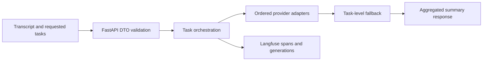

# Transcript Task Intelligence

**A FastAPI service that applies a caller-defined set of analysis tasks to a transcript, with interchangeable LLM providers, task-level failover and traceable execution.**

A single transcript may need several distinct analyses: decisions, ownership, deadlines or a domain-specific summary. Provider availability and response formats complicate a reliable API. This service separates the HTTP contract, orchestration, provider SDKs and monitoring so that each requested task can fall back independently instead of discarding successful work when one provider fails.

## Architecture and data flow



## Implementation decisions

1. The LLMProvider abstraction isolates orchestration from provider-specific SDKs. OpenAI, Yandex and DeepSeek adapters are separate infrastructure components.

2. Fallback is evaluated for each requested task. A provider failure does not automatically erase earlier successful task results; complete provider failure is exposed as HTTP 503.

3. The API receives tasks from the caller. It does not discover a new task taxonomy or train an extraction model from the transcript.

4. Synchronous provider work is dispatched through a threadpool from the asynchronous endpoint. This avoids directly blocking the event loop on SDK calls, while concurrency, provider quotas and timeouts still require deployment-level limits.

5. Trace spans and generation observations close in finally paths for both success and failure. Monitoring failures and model failures should be distinguishable in an operational deployment.

6. Client construction is lazy and cached. Importing the FastAPI application for offline checks does not require live provider credentials. Shutdown flushes monitoring only if it was initialized.

## Source navigation

| Module | Responsibility |
| --- | --- |
| `main.py` | FastAPI application lifecycle and /v1 router registration |
| `src/core/agents/summarization.py` | Per-task orchestration and provider fallback |
| `src/infrastructure/api/v1/routers/agents.py` | POST /v1/agents/summarize and error mapping |
| `src/infrastructure/providers` | Provider-specific request/response adapters |
| `src/infrastructure/llm_monitoring` | Trace, span and generation integration |

## Reproducible component checks

The minimal checks use Python 3.11/3.12 and `requirements-checks.txt`. They are independent of live accounts, paid APIs and GPU inference. They exercise the specific boundary described below; they are not a measurement of the complete application's model quality.

Linux/macOS, from the repository root:

```bash
python3.11 -m venv .venv
.venv/bin/python -m pip install -r requirements-checks.txt
.venv/bin/python offline_demo.py
.venv/bin/python -m unittest discover -s tests/offline -v
.venv/bin/python scripts/check_source.py
```

Windows PowerShell, from the repository root:

```powershell
py -3.11 -m venv .venv
& ./.venv/Scripts/python.exe -m pip install -r requirements-checks.txt
& ./.venv/Scripts/python.exe offline_demo.py
& ./.venv/Scripts/python.exe -m unittest discover -s tests/offline -v
& ./.venv/Scripts/python.exe scripts/check_source.py
```

### What the replay actually verifies

The offline suite injects clearly identified fixture providers into the actual orchestration and FastAPI application. One provider fails and a second returns a fixed response. Checks cover fallback, response structure, completion of monitoring observations, lifespan behavior and HTTP error handling. No model generates text in this test, and no paid provider is contacted.

The recorded example output is in [docs/offline-demo-output.json](docs/offline-demo-output.json). CI checks the minimal suite separately from a Gitleaks secret scan. Source compilation verifies syntax; it does not instantiate every runtime integration.

## Full runtime and configuration

The live entry point is `python main.py`. Install the complete `requirements.txt` in a dedicated environment and review `src/config/app_config.py` for provider and Langfuse configuration. Run `python scripts/prepare_config.py` to create missing local configuration files without overwriting existing ones. The HTTP response exposes `data.summary` as a string; it is not a labeled obligations dataset or a validated task-extraction JSON schema.

Runtime dependencies and configuration notes are documented in [docs/runtime.md](docs/runtime.md). Minimal and full-runtime environments are intentionally separate. Filled local settings, credentials, production exports and original Git history are outside the source export. Configuration examples describe shape and environment references; they are not a working customer account.

## Evaluation protocol

A model-quality study needs a permitted transcript corpus, independent annotations and a frozen task taxonomy. Evaluate each requested task separately, measure unsupported statements and omitted obligations, and report complete/partial failures alongside latency, cost and provider-version information. Fixtures cannot establish answer quality or production throughput.

## Current boundaries

- Caller-supplied tasks and a string summary are the implemented contract.
- Live SDK compatibility, load behavior and provider quality are separate from offline orchestration checks.
- No fine-tuned model, training dataset or held-out extraction score is included.

This repository presents the reviewed, anonymized source and the reproducible component checks described above. Private account configuration, customer identities, production documents, recordings and original deployment settings are excluded. Full application-level evaluation remains separate from the offline checks.

## Provenance and dependencies

The source export belongs to the author's local project family; technical component boundaries are recorded in [docs/source-provenance.json](docs/source-provenance.json). Third-party libraries, pretrained models and adapters retain their own licenses and attribution; see [THIRD_PARTY.md](THIRD_PARTY.md). No new permissive license is assigned by this documentation update.

Where present, [docs/original-guide.md](docs/original-guide.md) preserves the implementation guide with neutralized service names. It is reference material and must be read together with the current runtime and validation boundaries above. It is not a claim of production readiness.
